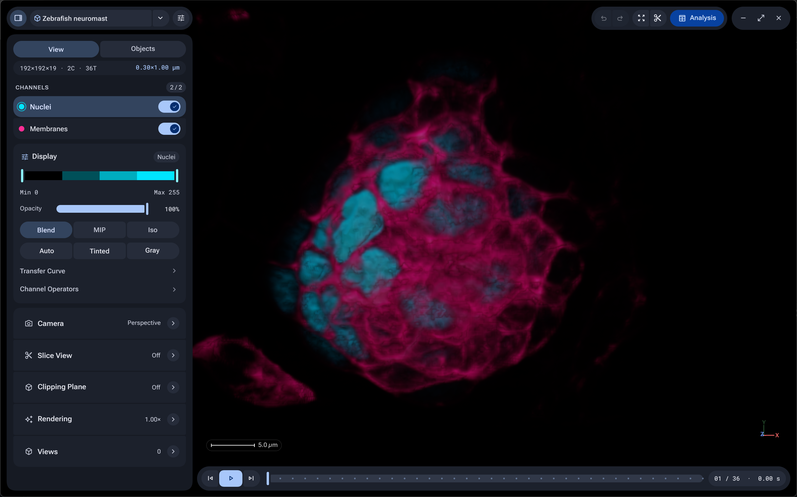

  

<h1 align="center">Grana</h1>

A next-generation microscopy platform for 3D and 4D imaging.

  
  
  

  

## What is Grana

Grana is a next-generation 3D and 4D microscopy platform written in Rust, delivering high performance with a low memory footprint. Open major microscopy formats directly to explore large volumes, segment and track structures over time, automate batch analysis, and export results as images, videos, and other formats.

## Formats

### Import

- **Microscopy images** — OME-TIFF, classic and BigTIFF, as single files or pyramids of `.ome.tif`, `.ome.tiff`, `.tif`, `.tiff` in 8-bit, 16-bit and 32-bit float, compressed with none, Deflate, LZW or PackBits
- **OME-Zarr** — versions 0.4 to 0.6, read from a local folder or over HTTP, including plates, collections and bioformats2raw image groups
- **Vendor formats** — ZEISS CZI (`.czi`), Nikon ND2 (`.nd2`), the Leica LIF family (`.lif`, `.lof`, `.lifext`, `.xlif`, `.xlef`, `.xlcf`, `.xllf`) and Imaris IMS (`.ims`)
- **Imaris objects** — surfaces, spots, filaments, tracks and their statistics, read from an `.ims` file together with the image
- **Localization tables** — Picasso HDF5 (`.h5`, `.hdf5`) and delimited text (`.csv`, `.tsv`, `.txt`, `.dat`)
- **Tracking graphs** — GEFF stores of points, surfaces or filaments
- **Grana records** — projects (`.grana`), share packages (`.granashare`) and batch protocols (`protocol.toml`)

### Export

- **OME-TIFF** — pyramids in 8-bit, 16-bit or 32-bit float with OME-XML metadata
- **OME-Zarr** — versions 0.5 and 0.6, with pyramid levels, channel colours and object label images
- **Raster images** — PNG in 8-bit or 16-bit, and PNG frame sequences
- **Vector pages** — figures, charts and track lineages as SVG or PDF
- **Movies** — MP4 with H.264, MOV with lossless PNG frames for alpha, and PNG frame sequences
- **Meshes** — Wavefront OBJ, STL and glTF binary (GLB)
- **Tables** — statistics, colocalization, relations and the Ripley curve as CSV
- **Localization tables** — Picasso HDF5 (`.hdf5`)
- **Tracking graphs** — GEFF 1.0 stores
- **Grana records** — projects (`.grana`), share packages (`.granashare`) and batch protocols (`protocol.toml`)
- **Provenance** — RO-Crate packages for a batch run and for a share package

## Download

Installers are on the [Releases](https://github.com/formetaohy/Grana/releases) page.

## Status

Grana is in early access, so expect a few rough edges — and plenty of improvements. If you run into a bug or have an idea, feel free to open an [issue](https://github.com/formetaohy/Grana/issues) or email me at [formetaohy@gmail.com](mailto:formetaohy@gmail.com).

## License

[MIT](LICENSE) · © 2026 taohy
